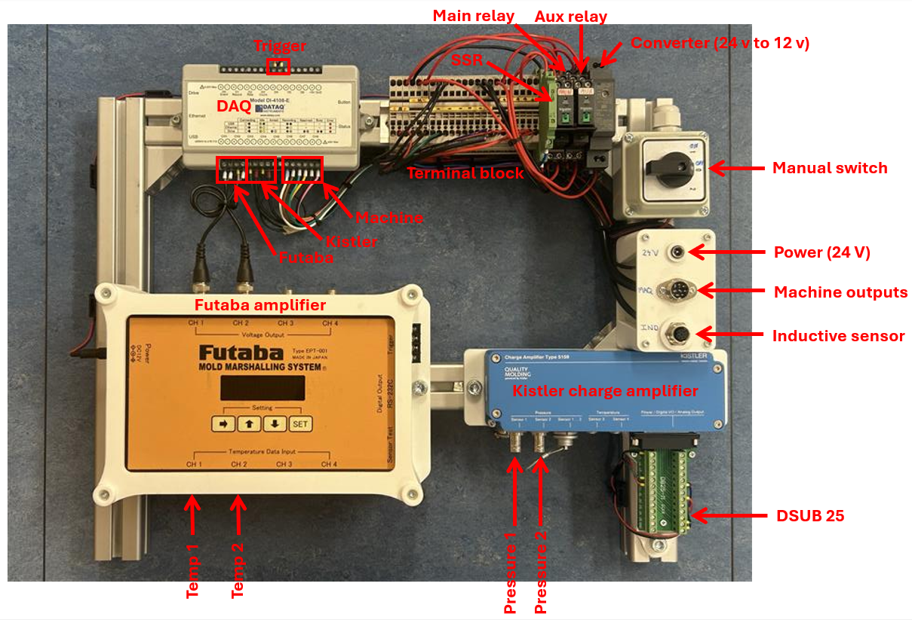

# `monitoring-injection-molding`
Integration of temperature and pressure sensors inside the cavity of an injection mold with real-time monitoring. Automatic cycle detection via an inductive proximity sensor or machine trigger. The machine signals (injection pressure, screw speed and screw position) are read on the same DAQ scan as the in-mold sensors, so each detected cycle is saved with all channels time-aligned.

# Hardware

UPDATE photos: added new connector for machine outputs and rewired 




## Mold sensors:

| Kistler Piezoelectric (0–2000 bar) | Futaba IR (60–430 ºC) | Inductive Proximity | 
|:----------:|:---------:|:---------:|
|  |  |  |


**Why piezoelectric over piezoresistive?**
Injection molding involves rapid pressure spikes during filling. Piezoelectric sensors excel at capturing these fast, dynamic events with high linearity and are robust under high pressures and temperatures. However, they require charge amplifiers and are unsuitable for long-term static measurements due to drift.


**Why IR over thermocouple?**
IR sensors offer non-contact, fast-response measurement (<8ms) of melt temperature, unaffected by mold conduction. Thermocouples, though cost-effective, can have their melt temperature readings altered by heat conduction from the surrounding mold steel.


## Circuit

The three trigger sources (manual switch, inductive proximity sensor and machine signal) are wired **in parallel onto the main relay coil**, so any of them energizes it and all can be active at the same time.


**Relay Logic**
- Auxiliary relay: converts the inductive sensor's electronic output into a mechanical contact, protecting the sensor electronics from the manual switch's direct 24 V supply.
- Solid-state relay: acts as a switch driven by the machine's 0–10 V output, keeping the machine side isolated from the coil.
- Main relay: two poles. Pole 1 applies the 24 V reset signal to the charge amplifier's trigger/reset input (pin 19), discharging its internal capacitance to eliminate drift; pole 2 (COM 21 / NC 22) is a free contact wired to a DAQ digital input, which tells the program when to record.

**Dry Contact**
The DAQ digital inputs are idle-HIGH (internal pull-up) and only react to being pulled down to ground, hence the voltage-free contact: relay released, the input is grounded and reads 0; relay energized, the contact opens and it reads 1 = cycle running.

**Pull-Down Resistor (10 kΩ)**
Between the main relay's NO contact and ground, it holds the charge amplifier's trigger pin at a defined LOW (0 V) while the relay is open, preventing false triggering from electrical noise.

## Unit conversions:

Every channel is read as a raw ADC count and first scaled to volts. The DAQ input range is ±10 V with a 16-bit signed converter, so 32768 counts = 10 V:

`V = raw × 10 / 32768`

That voltage is then converted per channel type. The values below are the defaults in `config/daq_config_defaults.json`. For the machine signals, `R` is the resolution given by the machine (mV per unit) and `initial` the value at 0 V.

| Signal | Conversion | Default |
|--------|------------|---------|
| Futaba (`T_futaba`) | `°C = V × deg_per_volt` | 100 °C/V |
| Kistler (`P_kistler`) | `bar = V × (Qmax / s) / 10` | Qmax = 20000 pC, s = 2.500 |
| Injection pressure (`P_machine`) | `bar = initial + mV / R` | R = 20 mV, initial = 0 |
| Injection speed (`vel_screw`) | `cm³/s = initial + mV / R` | R = 100 mV, initial = 0 |
| Screw position (`pos_screw`) | `mm = initial + mV / R` | R = 100 mV, initial = 0 |

# Software

UPDATE demo and software (leave that as a reminder for me)


# IoT

The compact settings row below the toolbar accepts a machine ID, material/grade,
mold-temperature setpoint (°C), and limit-pressure setting (bar). Blank values
mean unknown. Use the **check mark** to apply edits to subsequent cycles;
each cycle keeps the values present at its
start. Change the machine only while stopped. These reusable operator settings
are remembered in ignored `data/run_setup.json`; DAQ sampling settings remain
unchanged.

The **history icon** beside Save and Send opens **Cycle history**, listing
recordings across sessions in this app run. Select
the intended machine/session/cycle and enter one part's weight (g) and spiral
length (mm). Corrections and clearing a value are supported. With MQTT enabled,
measurement edits are queued separately from waveforms; **Send** in the history window
is an explicit manual send when automatic MQTT is off. Load a saved metadata
file with **Load…** to edit earlier sessions after restarting the application.

**Save** writes three files together in the selected folder:

- `recording.csv`: sensor readings, with columns `session_id, cycle_id,
  session_cycle, timestamp_ns, time_s, CH<n>_<type>, ...` in that order.
- `recording.cycles.csv`: one row per cycle with machine ID, session/cycle IDs,
  material, mold setpoint, pressure settings, latest weight/spiral length,
  acquisition mode/status/reason, sample count, exact time bounds and measurement
  revision. Unknown values are blank; real zero measurements remain zero.
- `recording.metadata.json`: full captured configuration, calibration, channel
  units and measurements, retained for the history window's **Load…** action.

Keep the files together. Join the CSVs on `session_id` and `cycle_id`; the cycle
summary supplies `machine_id` for the server's full identity. Machine ID and
sample index are not repeated in the waveform CSV. Use the waveform CSV with
`scripts/plot_csv_raw.py`. Save again after editing measurements to update the
exported companions; earlier exports do not update automatically.

Recordings and unsaved measurements remain in memory; no automatic recording
archive or recovery journal has been added. Interrupted cycles retain their
identity and are labeled separately from completed cycles. Save/Next wait for
final worker data; the monitoring-duration limit uses total session elapsed time.

The cloud path is **MQTT ? Node-RED ? InfluxDB waveforms + PostgreSQL metadata ?
Grafana**. One version-1 capture envelope carries cycle identity/settings once
and the waveform samples separately. Influx retains `machine_id`/`session_id`
tags and the numeric `cycle_num` field. PostgreSQL stores one metadata row per
`(machine_id, session_id, cycle_id)`. Weight/length edits use independent,
revisioned messages. Old queued record arrays remain supported by the new flow.

Failed MQTT publishes continue to use `data/pending/` and retry on reconnection.
Broker acknowledgement is not database confirmation; the GUI labels queued
messages as unconfirmed. There is no new end-to-end delivery guarantee.

**Deploy the server changes before using cloud upload from this version.** Follow
[iot/SERVER_SETUP.md](iot/SERVER_SETUP.md) for backups, schema, complete Node-RED
flow import, historical catalog backfill, Grafana configuration and rollback.
No waveform migration or Influx field rename is required.

Connect to the server:

```shell
ssh 'eduard.almar@local.eurecat.org'@172.20.48.28
```

Query the database (from the local machine, over ssh):

```shell
# print only the last 5 rows
ssh 'eduard.almar@local.eurecat.org'@172.20.48.28 \
"docker exec influxdb influx -database sensor_data -execute 'SELECT * FROM sensor_data ORDER BY time DESC LIMIT 5'"

# delete
ssh 'eduard.almar@local.eurecat.org'@172.20.48.28 "docker exec influxdb influx -database sensor_data -execute 'DELETE FROM sensor_data'"

# download
ssh 'eduard.almar@local.eurecat.org'@172.20.48.28 "docker exec influxdb influx -database sensor_data -execute 'SELECT * FROM sensor_data' -format csv" > /mnt/c/Users/eduard.almar/Downloads/sensor_data_dump.csv
```

| Service | URL | How to load the code in `/iot` |
|---------|-----|--------------------------------|
| Grafana | http://172.20.48.28:3000/ | Edit > Settings > JSON model, and paste `grafana_dashboard.json` |
| Node-RED | http://172.20.48.28:1880/ | Import the complete `nodered_flows.json`; configure PostgreSQL and HTTP writer credentials as described in `SERVER_SETUP.md` |


# Installation Manual

## Futaba

| Step | Description | Reference |
|------|-------------|-----------|
| 1 | Press the calibration button of the amplifier **with the mold open**. |  |
| 2 | Connect the Futaba inputs. |  |
| 3 | Connect the cables that stick out of the box to the preamplifiers. |  |
| 4 | Secure the preamplifiers using the threaded screws. |  |

## Kistler

| Step | Description | Reference |
|------|-------------|-----------|
| 1 | Connect the Kistler inputs 1 and 2. |  |
| 2 | Connect the mold pressure outputs. |  |

## Final Installation

| Expected result |
|-----------------|
|  |
