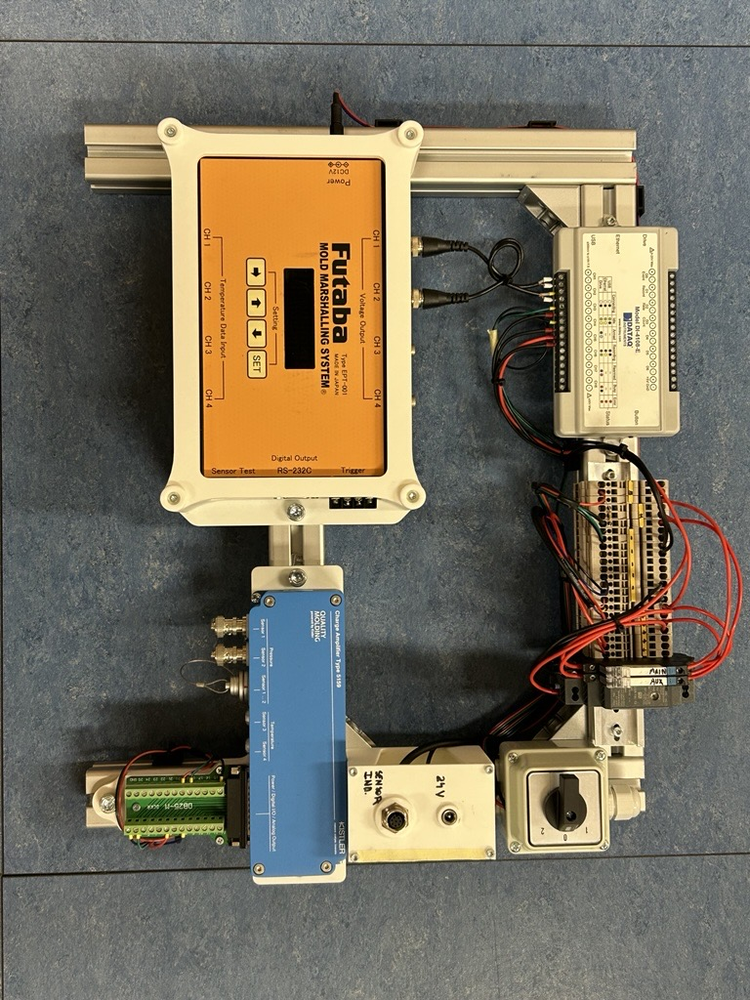
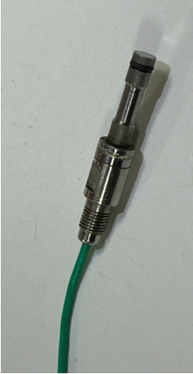
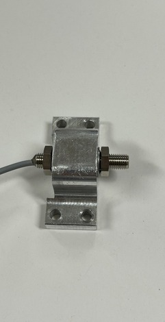
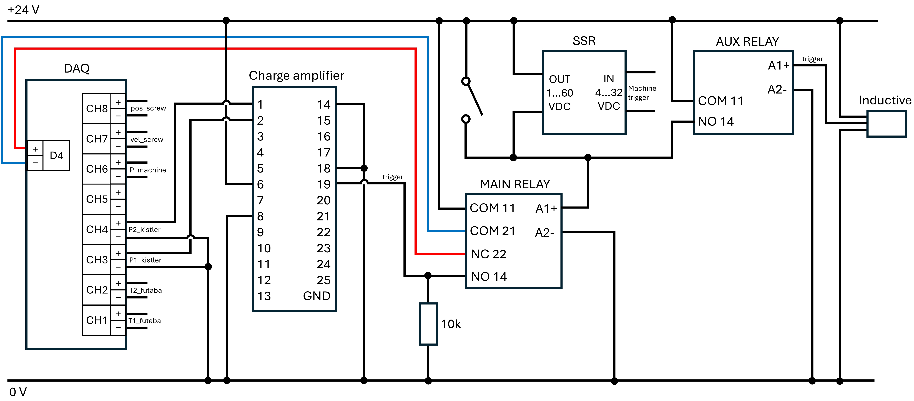
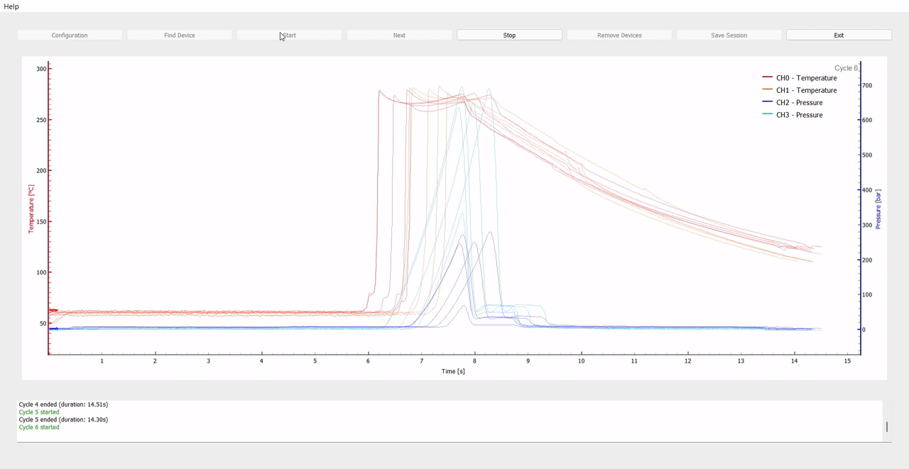
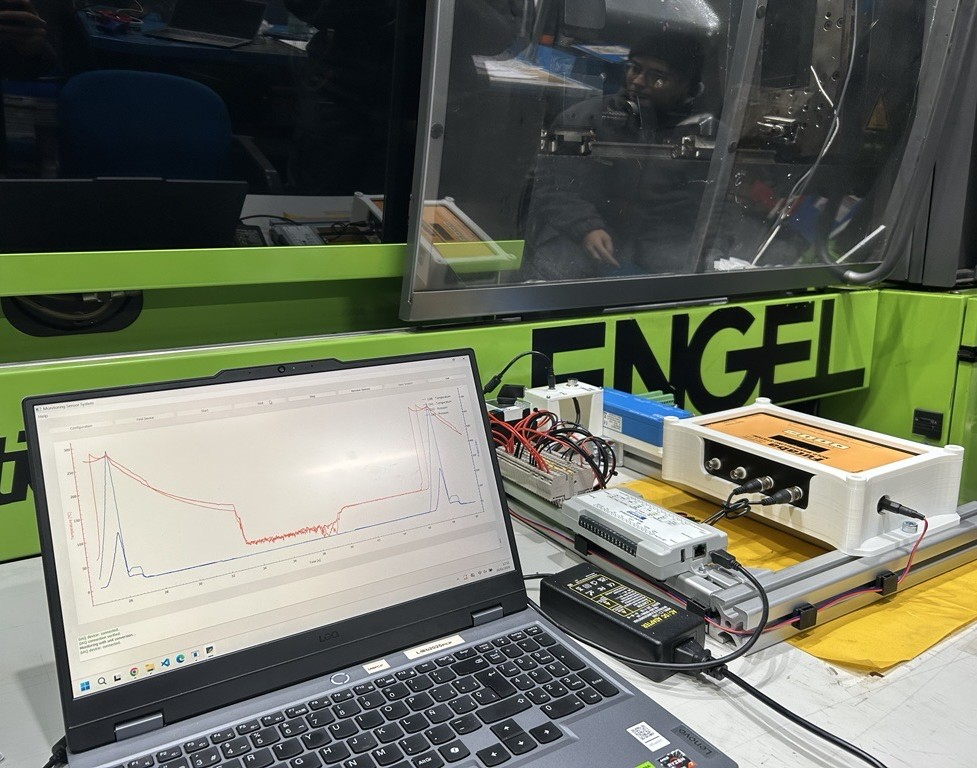

# `monitoring-injection-molding`
Integration of temperature and pressure sensors inside the cavity of an injection mold with real-time monitoring. Automatic cycle detection via an inductive proximity sensor or machine trigger. The machine signals (injection pressure, screw speed and screw position) are read on the same DAQ scan as the in-mold sensors, so each detected cycle is saved with all channels time-aligned.

# Hardware

UPDATE photos: added new connector for machine outputs and rewired 




## Mold sensors:

| Kistler Piezoelectric (0–2000 bar) | Futaba IR (60–430 ºC) | Inductive Proximity | 
|:----------:|:---------:|:---------:|
|  |  |  |


**Why piezoelectric over piezoresistive?**
Injection molding involves rapid pressure spikes during filling. Piezoelectric sensors excel at capturing these fast, dynamic events with high linearity and are robust under high pressures and temperatures. However, they require charge amplifiers and are unsuitable for long-term static measurements due to drift.


**Why IR over thermocouple?**
IR sensors offer non-contact, fast-response measurement (<8ms) of melt temperature, unaffected by mold conduction. Thermocouples, though cost-effective, can have their melt temperature readings altered by heat conduction from the surrounding mold steel.


## Circuit

The three trigger sources (manual switch, inductive proximity sensor and machine signal) are wired **in parallel onto the main relay coil**, so any of them energizes it and all can be active at the same time.




**Relay Logic**
- Auxiliary relay: converts the inductive sensor's electronic output into a mechanical contact, protecting the sensor electronics from the manual switch's direct 24 V supply.
- Solid-state relay: acts as a switch driven by the machine's 0–10 V output, keeping the machine side isolated from the coil.
- Main relay: two poles. Pole 1 applies the 24 V reset signal to the charge amplifier's trigger/reset input (pin 19), discharging its internal capacitance to eliminate drift; pole 2 (COM 21 / NC 22) is a free contact wired to a DAQ digital input, which tells the program when to record.

**Dry Contact**
The DAQ digital inputs are idle-HIGH (internal pull-up) and only react to being pulled down to ground, hence the voltage-free contact: relay released, the input is grounded and reads 0; relay energized, the contact opens and it reads 1 = cycle running.

**Pull-Down Resistor (10 kΩ)**
Between the main relay's NO contact and ground, it holds the charge amplifier's trigger pin at a defined LOW (0 V) while the relay is open, preventing false triggering from electrical noise.

## Unit conversions:

Every channel is read as a raw ADC count and first scaled to volts. The DAQ input range is ±10 V with a 16-bit signed converter, so 32768 counts = 10 V:

`V = raw × 10 / 32768`

That voltage is then converted per channel type. The values below are the defaults in `config/daq_config_defaults.json`. For the machine signals, `R` is the resolution given by the machine (mV per unit) and `initial` the value at 0 V.

| Signal | Conversion | Default |
|--------|------------|---------|
| Futaba (`T_futaba`) | `°C = V × deg_per_volt` | 100 °C/V |
| Kistler (`P_kistler`) | `bar = V × (Qmax / s) / 10` | Qmax = 20000 pC, s = 2.500 |
| Injection pressure (`P_machine`) | `bar = initial + mV / R` | R = 20 mV, initial = 0 |
| Injection speed (`vel_screw`) | `cm³/s = initial + mV / R` | R = 100 mV, initial = 0 |
| Screw position (`pos_screw`) | `mm = initial + mV / R` | R = 100 mV, initial = 0 |

# Software

UPDATE demo and software (leave that as a reminder for me)






# IoT

When cloud upload is enabled, each finished cycle is published as a batch of JSON records to the topic `<machine_id>/sensors` (e.g. `160t/sensors`) on the broker running in the server (`BROKER` / `PORT` in `.env`). The topic follows the Machine ID picked in the config window, so moving the box between machines is one dropdown. Node-RED subscribes to `+/sensors`, turns every record into a point and writes it to InfluxDB, which Grafana reads to plot the cycles. Every record carries `timestamp_ns`, `machine_id`, `session_id`, `cycle_id` and one field per channel (`CH<n>_<type>`), using exactly the same names as the columns of the local CSV. If the broker is unreachable, the batches are stored in `data/pending/` and sent automatically once it is back, so no cycle is lost.

Connect to the server:

```shell
ssh 'eduard.almar@local.eurecat.org'@172.20.48.28
```

Query the database (from the local machine, over ssh):

```shell
# print only the last 5 rows
ssh 'eduard.almar@local.eurecat.org'@172.20.48.28 \
"docker exec influxdb influx -database sensor_data -execute 'SELECT * FROM sensor_data ORDER BY time DESC LIMIT 5'"

# delete
ssh 'eduard.almar@local.eurecat.org'@172.20.48.28 "docker exec influxdb influx -database sensor_data -execute 'DELETE FROM sensor_data'"

# download
ssh 'eduard.almar@local.eurecat.org'@172.20.48.28 "docker exec influxdb influx -database sensor_data -execute 'SELECT * FROM sensor_data' -format csv" > /mnt/c/Users/eduard.almar/Downloads/sensor_data_dump.csv
```

| Service | URL | How to load the code in `/iot` |
|---------|-----|--------------------------------|
| Grafana | http://172.20.48.28:3000/ | Edit > Settings > JSON model, and paste `grafana_dashboard.json` |
| Node-RED | http://172.20.48.28:1880/ | batch tab > function 1, and paste `nodered_function.js` |


# Installation Manual

## Futaba

| Step | Description | Reference |
|------|-------------|-----------|
| 1 | Press the calibration button of the amplifier **with the mold open**. |  |
| 2 | Connect the Futaba inputs. |  |
| 3 | Connect the cables that stick out of the box to the preamplifiers. |  |
| 4 | Secure the preamplifiers using the threaded screws. |  |

## Kistler

| Step | Description | Reference |
|------|-------------|-----------|
| 1 | Connect the Kistler inputs 1 and 2. |  |
| 2 | Connect the mold pressure outputs. |  |

## Final Installation

| Expected result |
|-----------------|
|  |