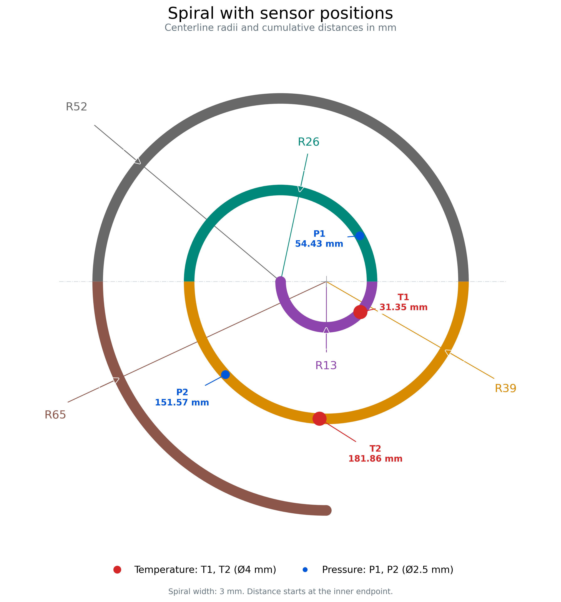

# Geometría de la espiral y sensores del molde

Fuente: copia sin modificar de [spiral_sensors.py](../hardware/mechanical/geometry/spiral_sensors.py), suministrada en la carpeta `quality control`. Todos los valores del modelo están en milímetros. Este modelo describe la geometría ideal, no una medición de piezas inyectadas.

[Versión SVG editable](../hardware/mechanical/geometry/spiral_sensors.svg). El PNG original suministrado permite visualizar el mismo esquema en Markdown sin depender de soporte SVG.

## Recorrido nominal

El script concatena cuatro semicírculos y un cuarto de círculo. La distancia se mide desde el extremo interior sobre la línea central.

| Tramo | Radio | Centro (x, y) | Ángulo inicial–final | Longitud |
| --- | ---: | --- | --- | ---: |
| 1 | 13 | (13, 0) | 180°–360° | 40,8407 |
| 2 | 26 | (0, 0) | 0°–180° | 81,6814 |
| 3 | 39 | (13, 0) | 180°–360° | 122,5221 |
| 4 | 52 | (0, 0) | 0°–180° | 163,3628 |
| 5 | 65 | (13, 0) | 180°–270° | 102,1018 |

`L = π × (13 + 26 + 39 + 52) + π × 65 / 2 = 510,5088062083 mm`.

El valor se redondea a **510,51 mm** en el PowerPoint. Es longitud de línea central: no es perímetro de la silueta, no incluye el palo vertical de la colada ni añade el radio de los remates dibujados en los extremos.

`SPIRAL_WIDTH_MM = 3.0` define el ancho de la banda dibujada. La descripción del usuario sitúa el diámetro del hilo real aproximadamente entre 3 y 4 mm. No se ha alterado el script para hacer coincidir ambas referencias.

La envolvente ideal de la banda de 3 mm es aproximadamente **107 × 120 mm**: x entre −53,5 y 53,5; y entre −66,5 y 53,5. Este cálculo no incluye colada, deformaciones, soportes ni margen de colocación. Para diseñar el campo útil se mantiene el requisito de 150 × 150 mm y la opción conservadora de 200 × 200 mm.

## Posiciones de los sensores

Estos son sensores de temperatura y presión del **molde**, no componentes nuevos de la celda de inspección. Las coordenadas siguen el sistema del script y no son coordenadas de píxel.

| Sensor | Distancia desde el anterior | Distancia desde el inicio | x | y | Radio del tramo |
| --- | ---: | ---: | ---: | ---: | ---: |
| T1 | 31,35 | 31,35 | 22,6868 | −8,6698 | 13 |
| P1 | 23,08 | 54,43 | 22,5288 | 12,9790 | 26 |
| P2 | 97,14 | 151,57 | −15,6733 | −26,4357 | 39 |
| T2 | 30,29 | 181,86 | 11,0776 | −38,9526 | 39 |

El dibujo usa Ø4 mm para T1/T2 y Ø2,5 mm para P1/P2. Son diámetros de los marcadores definidos por el modelo; no deben confundirse con el diámetro del hilo.

## Uso previsto

- Referencia para entender el recorrido, sus extremos y la relación espacial con los sensores del proceso.
- Base para diseñar fixtures y ejemplos geométricos, manteniendo el ajuste a piezas reales como una tarea independiente.
- Posible referencia de posiciones de medida por distancia acumulada, si se acuerda esa definición.
- No imponer 510,51 mm al algoritmo de medición: debe poder detectar variaciones, contracción y llenados incompletos.

Los ficheros CAD recibidos están en [hardware/mechanical/cad/reference](../hardware/mechanical/cad/reference/README.md). No se han abierto ni validado sus cotas, revisiones o dependencias en CAD.
