# Propuesta inicial de control de calidad Machina

Resumen de las 11 diapositivas de [Solución control calidad Machina](references/Solucion_control_calidad_Machina.pptx), recopilado el 2026-11-04. Se conservan las imágenes y los dibujos originales. Es una propuesta de estudio, no un diseño construido ni una selección de compra.

**Actualización posterior del mismo día:** este documento conserva el contenido histórico del PPT. El usuario ha aclarado que 0,1 mm es orientativo, 2 m no son aceptables y la báscula debe costar hasta 300 € con IVA y conexión, preferiblemente con 0,01 g. Véanse [requisitos vigentes](requirements.md) y [revisión crítica del montaje](../hardware/research/2026-11-04_hardware_review.md).

## 1. Concepto de celda

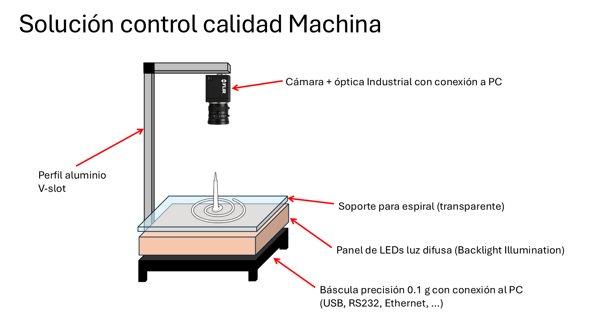

Una columna de aluminio sostiene la cámara cenital. La espiral se coloca sobre un soporte transparente; debajo se sitúan el panel de luz difusa y la báscula conectada al PC. El dibujo propone un objetivo de pesaje de 0,1 g. Hay que resolver qué elementos estarán realmente sobre la plataforma de pesaje y cómo se evita transmitir fuerzas desde la estructura.

## 2. Envolvente del montaje

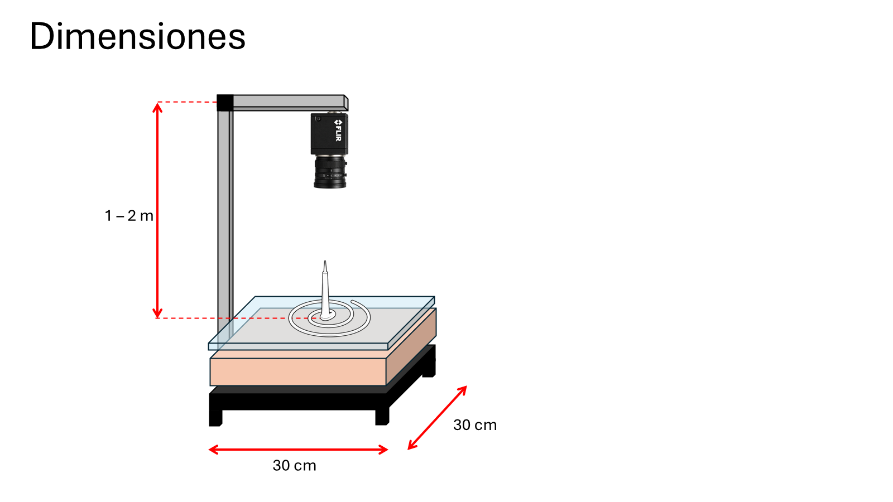

Base conceptual de 300 × 300 mm y altura de 1–2 m. No son dimensiones definitivas. La altura dependerá del FOV, la óptica, la condición de apoyo y el presupuesto de error. La envolvente de pieza indicada por el usuario es de 150 × 150 mm, o 200 × 200 mm de forma conservadora.

## 3. Geometría ideal

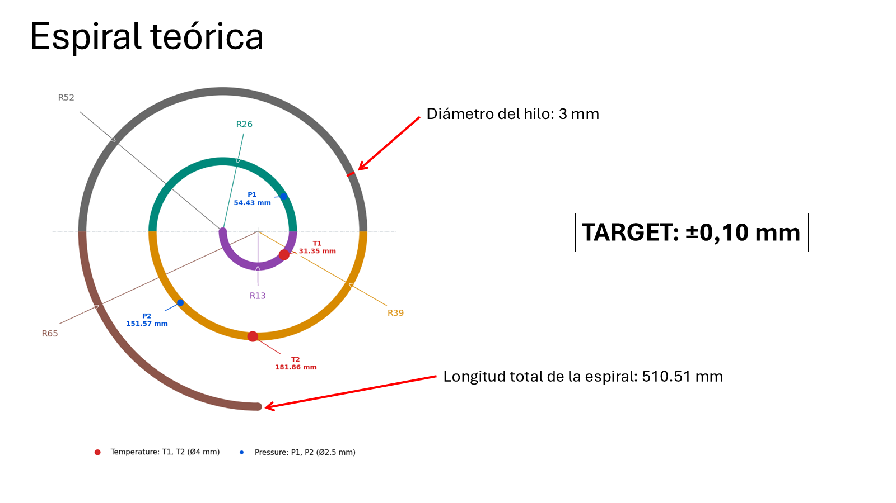

La diapositiva indica hilo de 3 mm, recorrido total de 510,51 mm y objetivo de ±0,10 mm. El [script y la tabla de sensores](geometry_reference.md) permiten reproducir la geometría. La longitud real de una pieza deformada o contraída no se obtiene sustituyéndola por ese nominal.

## 4. Piezas reales

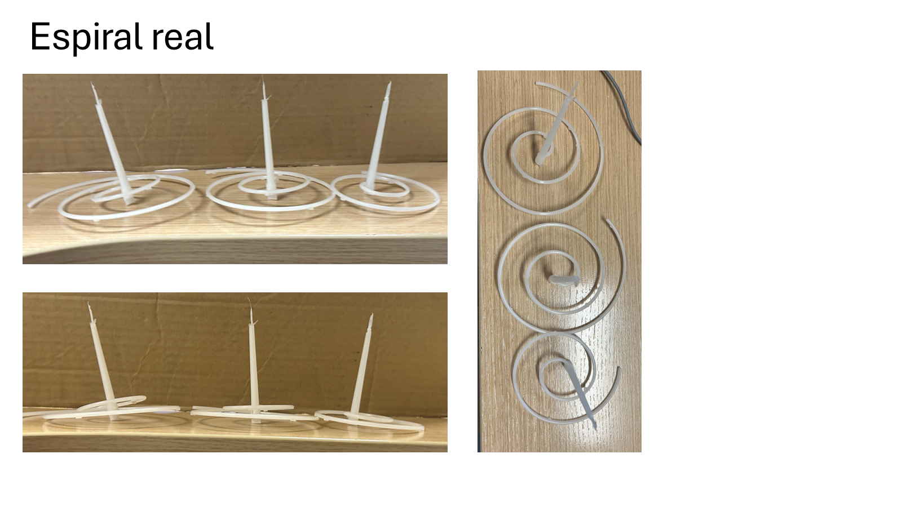

Las fotografías muestran espirales con colada vertical y distintas condiciones de apoyo. El usuario describe elevaciones locales de hasta aproximadamente 10 mm; las fotos no proporcionan una medición calibrada de esa altura.

Imágenes originales: [vista oblicua](assets/presentation/media/image4.jpeg), [vista lateral](assets/presentation/media/image5.jpeg) y [vista superior](assets/presentation/media/image6.jpeg).

## 5. Cámara y óptica propuestas

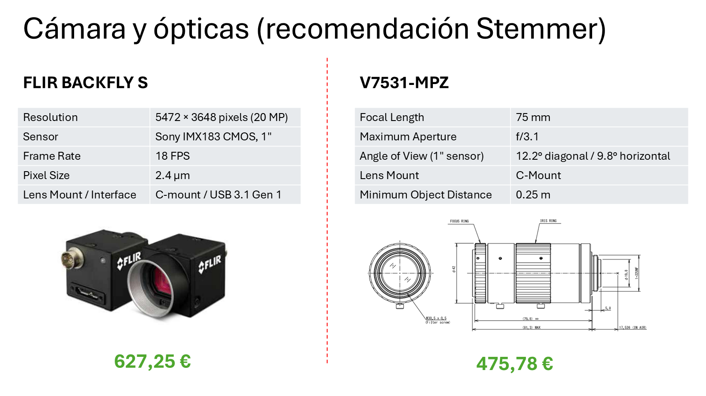

La oferta concreta el modelo monocromo **FLIR Blackfly S BFS-U3-200S6M-C** y la lente **Computar V7531-MPZ** de 75 mm. La cámara ofrece 5472 × 3648 píxeles, sensor Sony IMX183, píxel de 2,4 µm, montura C y USB 3.1 Gen 1. La lente tiene apertura máxima f/3,1 y enfoque desde 0,25 m según la ficha suministrada.

La propuesta comercial [IN26-1893](../hardware/components/quotes/IN26-1893.pdf), de 31/07/2026, desglosa:

| Partida | Importe sin IVA |
| --- | ---: |
| Cámara FLI-BFS-U3-200S6M-C | 627,25 € |
| Óptica CBC-IPZ-V7531 | 475,78 € |
| Cable USB 3, 2 m | 24,29 € |
| Transporte | 10,00 € |
| Base imponible | **1.137,32 €** |
| IVA | 238,84 € |
| Total con IVA | **1.376,16 €** |

Validez original: 15 días. El importe no incluye el resto de la celda y requiere actualización para una futura compra. Las [fichas técnicas](../hardware/components/datasheets/README.md) se han copiado al repositorio.

## 6. Estructura de aluminio

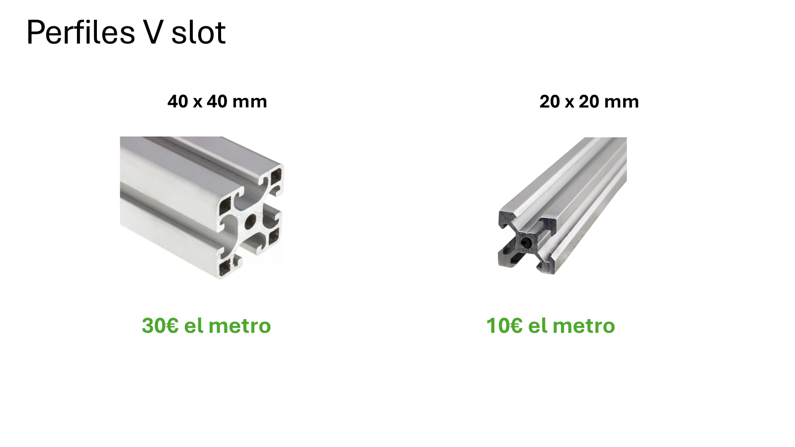

La presentación compara perfiles de 40 × 40 mm (30 €/m) y 20 × 20 mm (10 €/m). Son referencias históricas sin cálculo de rigidez, proveedor o impuestos confirmados. La selección debe considerar altura de columna, voladizo, unión cámara/óptica, vibración y anclaje.

## 7. Iluminación industrial

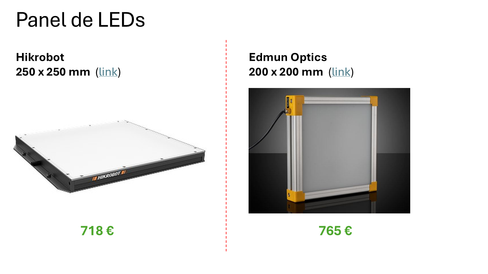

| Alternativa de la presentación | Tamaño indicado | Precio indicado | Enlace original sin parámetros de seguimiento |
| --- | --- | ---: | --- |
| Hikrobot | 250 × 250 mm | 718 € | [Referencia del distribuidor](https://www.ztec.dk/shop/hikrobot-310101593-hikrobot-mv-lbss-h-250-250-w-40604) |
| Edmund Optics | 200 × 200 mm | 765 € | [White 200 × 200 High Power LED Backlight](https://www.edmundoptics.es/p/white-200-x-200-high-power-led-backlight/49405/) |

Hay que distinguir área emisora útil y tamaño exterior. Si la zona requerida es de 200 × 200 mm, un panel con ese mismo tamaño útil no deja margen para errores de colocación.

## 8. Iluminación económica

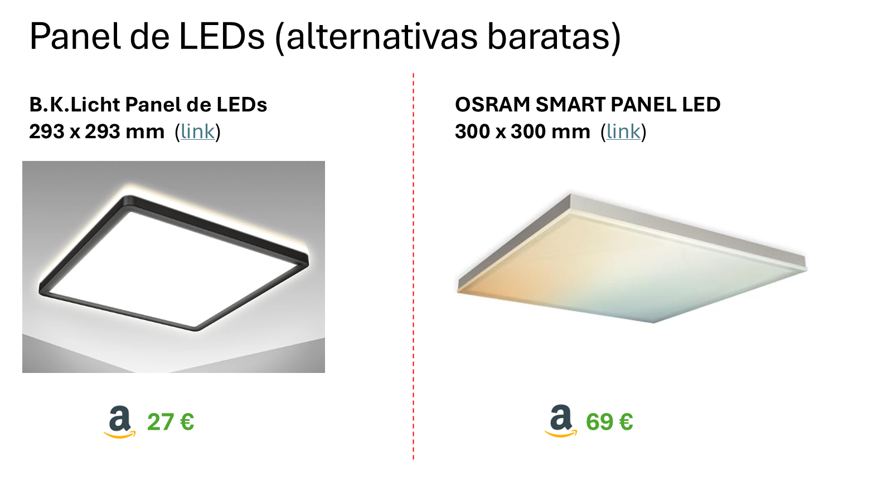

| Alternativa de la presentación | Tamaño indicado | Precio indicado | Enlace |
| --- | --- | ---: | --- |
| B.K.Licht | 293 × 293 mm | 27 € | [Referencia de la presentación](https://www.amazon.es/dp/B08J3W21R2) |
| OSRAM SMART PANEL LED | 300 × 300 mm | 69 € | [Referencia de la presentación](https://www.amazon.es/dp/B0FNN8NQ9L) |

Son candidatos para experimentación. Hay que comprobar qué superficie emite realmente luz, uniformidad, parpadeo, control y estabilidad. En particular, una luz de marco no equivale a un backlight uniforme de toda la superficie interior.

## 9. Básculas: primeras alternativas

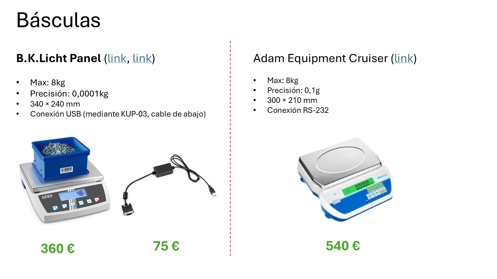

| Alternativa | Capacidad / incremento indicado | Plato indicado | Interfaz indicada | Precio del documento |
| --- | --- | --- | --- | ---: |
| KERN, modelo inferido del enlace TFKB 8K-4-B | 8 kg / 0,1 g | 340 × 240 mm | USB mediante adaptador | 360 € |
| Adaptador KERN, enlace TYKUP-03-B | No aplica | No aplica | USB / KUP, confirmar compatibilidad exacta | 75 € |
| Adam Equipment Cruiser | 8 kg / 0,1 g | 300 × 210 mm | RS-232 | 540 € |

La cabecera «B.K.Licht Panel» que aparece sobre la primera báscula parece un error de la presentación: la imagen y los enlaces corresponden a KERN. Se conserva la diapositiva original y se hace explícita esta inferencia.

Enlaces originales: [KERN TFKB 8K-4-B](https://www.kern-sohn.com/shop/es/productos/balanzas-industriales/balanzas-de-mesa/tfkb-8k-4-b/), [adaptador TYKUP-03-B](https://www.kern-sohn.com/shop/en/products/accessories/balances/interface-module/tykup-03-b/), [referencia Adam en RS](https://es.rs-online.com/web/p/balanzas/0687298).

## 10. Otras básculas

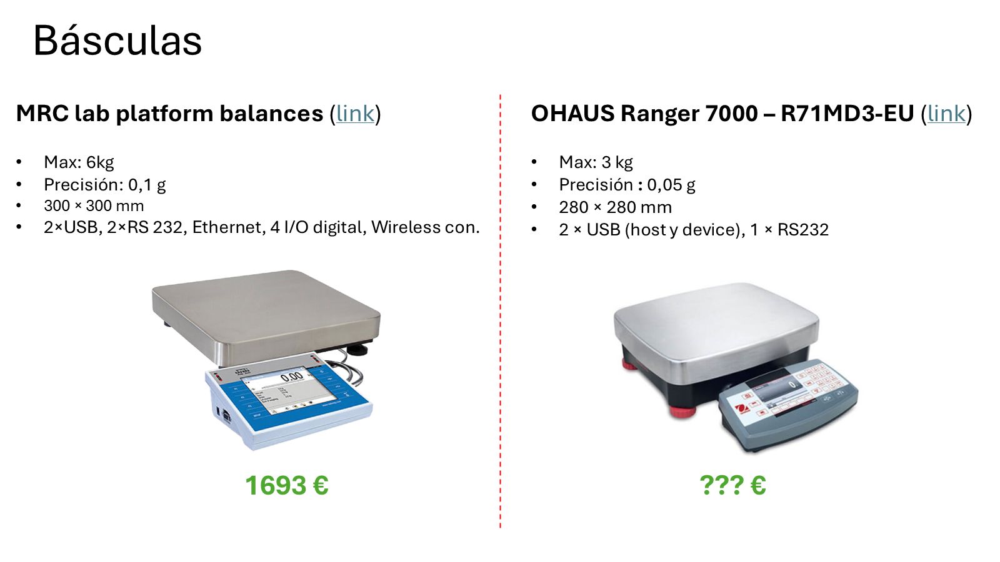

| Alternativa | Capacidad / incremento indicado | Plato indicado | Conectividad indicada | Precio del documento |
| --- | --- | --- | --- | ---: |
| MRC lab platform balances, modelo sin especificar | 6 kg / 0,1 g | 300 × 300 mm | 2 USB, 2 RS-232, Ethernet, 4 I/O digitales, conexión inalámbrica | 1.693 € |
| OHAUS Ranger 7000 R71MD3-EU | 3 kg / 0,05 g | 280 × 280 mm | 2 USB (host/device), RS-232 | TBD |

Enlaces originales: [familia MRC](https://www.mrclab.com/platform-balances-2) y [OHAUS Ranger 7000](https://europe.ohaus.com/en-eu/ranger7000-14). Las prestaciones se transcriben del PowerPoint y requieren confirmar modelo, protocolo y opciones instaladas. «Precisión» en esas diapositivas no se toma como demostración del error de pesaje.

## 11. Presupuesto inicial

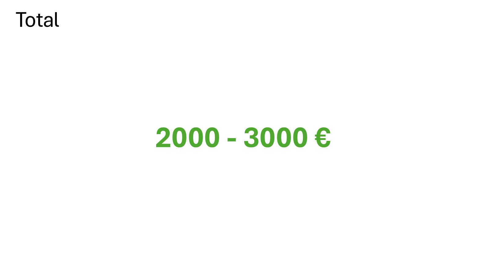

La propuesta estima **2.000–3.000 €**. Es una orientación histórica, no un total consolidado: depende de báscula, iluminación, estructura, soporte, calibración, accesorios e impuestos. El único desglose comercial copiado es el de cámara, lente, cable y transporte.

## Qué aporta este primer concepto

Define una disposición física y candidatos concretos. Antes de construir hay que cerrar metrología, soporte de la pieza, ruta de carga de la báscula, identificación de ciclo y cadencia. Los siguientes pasos están en [preguntas abiertas](open_questions.md), [investigación de hardware](../hardware/research/README.md) y [validación](../validation/README.md).
