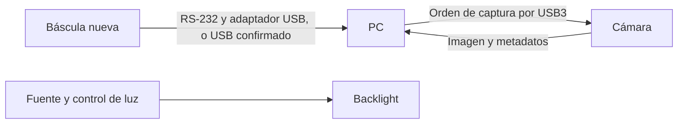

# Viabilidad de recibir peso y disparar la imagen

Investigación documental, 2026-11-04. No se ha conectado equipo ni implementado controlador. **La arquitectura solicitada es viable con PC + cámara USB3 + báscula serie; no necesita por principio un PLC ni un sensor de presencia adicional.** Quedan por ensayar comunicaciones, estabilización y correspondencia física de la captura.

## Evidencia de disparo

La documentación oficial de [FLIR BFS-U3-200S6, Acquisition Control](https://softwareservices.flir.com/BFS-U3-200S6/latest/Model/public/AcquisitionControl.html) describe `TriggerSource=Software` y `TriggerSoftware`. En adquisición continua con `FrameStart`, cada orden produce una imagen sin reiniciar adquisición para cada pieza. También documenta `Rolling` y `GlobalReset`, que son modos distintos. La página corresponde al firmware **1705.0.124.0 de 2017**, aunque su URL contenga `latest`; contrastar con la unidad y SDK suministrados.

La ruta de recepción continua de peso está documentada en los manuales de [U.S. Solid 5 kg](../research/deep_dive_2026-11-04/sources/USS_DBS28_61_51_5kg_manual.pdf), [Steinberg](../components/datasheets/SBS-LW-1030_manual.pdf) y [PCE](../components/datasheets/PCE-BSK_series_ES.pdf). La [comparativa](../components/scales_shortlist.md) conserva las diferencias y datos no publicados. Las básculas actuales del laboratorio no tienen USB ni RS-232 según el usuario; no se cuenta con ellas para automatización.

## Consecuencias para seleccionar hardware

- Para la primera prueba: luz continua estable, pieza inmóvil y disparo desde PC. Evaluar rolling shutter en estas condiciones antes de añadir control de flash.
- La báscula debe informar también ausencia/retirada. Una salida que solo imprime al pulsar no basta; una salida solo al estabilizarse necesita probar cómo comunica la retirada. Preferible disponer de modo continuo o consulta.
- Una señal de peso estable no demuestra por sí sola que hayan cesado todas las oscilaciones de la colada, de las vueltas o de la cámara. Verificarlo con imágenes repetidas durante la colocación.
- RS-232 requiere un convertidor **USB–RS-232**, no un cable UART TTL. Confirmar conector, cruce de pines y trama del modelo antes de comprar el cable.
- El panel necesita su propia fuente/controlador. La salida auxiliar de cámara no es una fuente para un panel de decenas de vatios.

## I/O y soporte de cámara: datos ya localizados

El [manual GPIO](https://softwareservices.flir.com/BFS-U3-200S6/latest/Family/GPIOConnector.htm) identifica Hirose HR10A-7R-6PB y conector complementario HR10A-7P-6S(73). Pin 2 es entrada optoaislada, 4 salida optoaislada, 5 su masa; 1 y 3 tienen funciones dobles y 6 es masa de alimentación. Las salidas requieren pull-up y respetar corriente/tensión: ver [características eléctricas](https://softwareservices.flir.com/BFS-U3-200S6/latest/Family/ElectricalGPIO.htm). **No hay un cable de flash diseñado ni autorizado por estos datos parciales**; faltan controlador y revisión final. La primera ruta USB no necesita este cable GPIO.

El [montaje oficial](https://softwareservices.flir.com/BFS-U3-200S6/latest/Family/Mounting.htm) especifica taladros M2/M3 de poca profundidad; usar el plano de la revisión concreta al fabricar el adaptador. La [guía térmica](https://softwareservices.flir.com/BFS-U3-200S6/latest/Family/Temperature.htm) aconseja contacto térmico con un soporte conductor y permite consultar `DeviceTemperature`. Esto favorece un adaptador metálico y registrar calentamiento; no implica añadir un ventilador que perturbe el pesaje.

No se ha validado todavía SDK/driver con el PC de producción. Mantener esa comprobación en la demostración del proveedor, sin instalar ahora dependencias en la aplicación de adquisición existente.
