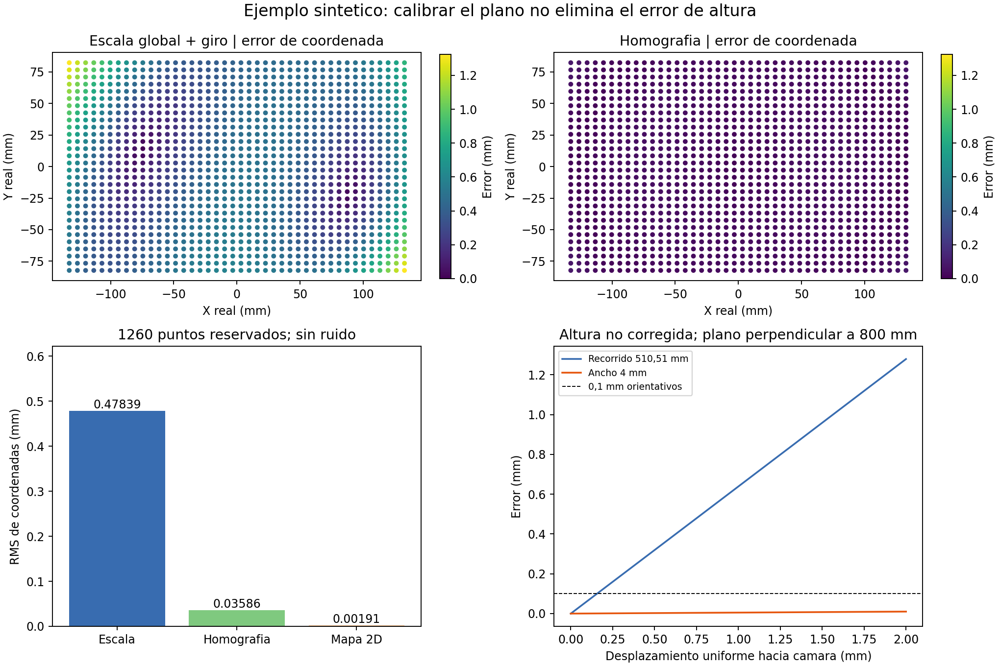

# Demostración numérica reproducible

2026-11-04. [Script](calibration_sensitivity.py), [resultados JSON](calibration_sensitivity.json), [figura PNG](calibration_sensitivity.png).

**Solo geometría sintética.** No se ha usado ninguna imagen de la FLIR, no se han estimado sus coeficientes y no se ha ensayado una pieza física. Este script pertenece a investigación, no a la aplicación de inspección.

## Qué se ha calculado

Se proyectan coordenadas conocidas sobre una imagen ideal de 5472 × 3648. Distancia central 800 mm, escala nominal 200/3648 mm/px, inclinaciones inventadas de 1,5° y 3° y distorsión radial inventada `k1=0,04` en coordenadas normalizadas. **No es una especificación Computar.** No hay ruido de detección ni error de patrón.

Se ajusta con 165 puntos y se comprueba con otros 1260 puntos interiores distintos:

| Transformación | RMS de error de coordenadas | Máximo |
| --- | ---: | ---: |
| Escala global + giro/traslación | 0,47839 mm | 1,32271 mm |
| Homografía | 0,03586 mm | 0,08646 mm |
| Mapa empírico RBF 2D | 0,00191 mm | 0,01829 mm |
| Inversión del modelo exacto conocido | <10⁻⁶ mm | <10⁻⁶ mm |

La última fila usa la verdad conocida del simulador, **no una calibración obtenida experimentalmente**. El RBF es una interpolación ilustrativa, no un algoritmo seleccionado ni una promesa de rendimiento. Cambiar distorsión, cobertura, ruido o interpolación cambia los resultados. Los errores de coordenadas tampoco son automáticamente errores de ancho o longitud: algunas componentes pueden cancelarse y otras acumularse.



El experimento muestra que corregir perspectiva con una homografía puede dejar distorsión residual. El mapa empírico también tiene error entre nodos, aunque conozcamos perfectamente los nodos de calibración.

## Escala equivocada con imagen idéntica

Multiplicar todas las coordenadas del patrón y la traslación cámara–patrón por `100/100,02` deja sus proyecciones sin cambios, hasta precisión numérica (~10⁻¹² píxeles). Sin embargo, esa interpretación de escala subestima 510,508806 mm en 0,10208 mm. Es una comprobación de la ambigüedad de escala, no una simulación de ruido.

## Altura

El panel de altura es un **segundo caso separado**, perpendicular y sin alabeo local: un objeto plano entero se acerca a la cámara, usando `error = longitud·h/(Z-h)`. No se deriva del plano inclinado de los otros paneles. Con `Z=800 mm`, desplazar 0,1 mm el plano cambia el recorrido de 510,508806 mm en 0,06382 mm, incluso con óptica perfectamente calibrada.

## Repetir

```powershell
py -3.11 -X utf8 inspection_cell/hardware/research/calibration_2026-11-04/calibration_sensitivity.py
```

Dependencias/versiones utilizadas en el JSON. El script comprueba que los puntos de prueba no coinciden con los de ajuste, caen en la imagen, que el modelo conocido se invierte correctamente y que la transformación de escala deja la imagen invariante. Se inspeccionó la figura. No se ejecutan pruebas del sistema DAQ porque no se ha modificado.
