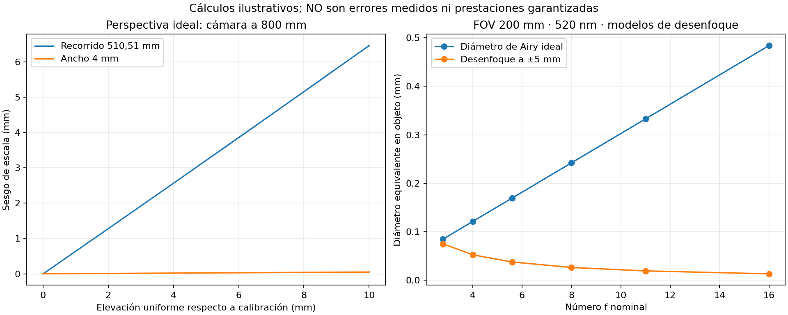

# Cálculos de sensibilidad: resultados y límites

Generados el 2026-11-04 con [geometry_sensitivity.py](geometry_sensitivity.py); datos completos en [JSON](geometry_sensitivity.json). Son ejemplos sintéticos con la geometría de cinco arcos del proyecto. **No son una simulación mecánica del material ni ensayos de la celda.**



## Altura: ancho y longitud no tienen el mismo error absoluto

Modelo pinhole, plano de calibración z=0 y cámara a Z=800 mm. Una elevación uniforme conserva la longitud real, pero cambia la escala por el factor `Z/(Z-h)`.

| Elevación h | Sesgo sobre ancho de 4 mm | Sesgo sobre recorrido de 510,509 mm |
| --- | ---: | ---: |
| 0,1 mm | +0,0005 mm | +0,0638 mm |
| 1 mm | +0,0050 mm | +0,6389 mm |
| 2 mm | +0,0100 mm | +1,2795 mm |
| 5 mm | +0,0252 mm | +3,2107 mm |
| 10 mm | +0,0506 mm | +6,4621 mm |

Si se exigiese que **solo esta contribución** fuese menor de 0,1 mm, el ejemplo exigiría altura uniforme desconocida menor de aproximadamente 0,157 mm para la longitud, pero permitiría unos 19,5 mm para el ancho. No son tolerancias propuestas para el soporte: una pieza alabeada, la orientación local y otras contribuciones requieren otro análisis. Muestran que 0,1 mm sobre 4 mm es un 2,5 %, mientras que sobre 510,5 mm es aproximadamente un 0,0196 %.

## La altura máxima no basta para conocer la longitud espacial

Se comparan casos con cámara a 800 mm y sin ruido ni oclusión. La proyección ortográfica representa una vista ideal sin cambio de escala con altura.

| Ejemplo | Longitud espacial | Proyección ortográfica | Longitud aparente con perspectiva |
| --- | ---: | ---: | ---: |
| Plana, z=0 | 510,509 | 510,509 | 510,509 |
| Misma curva elevada 10 mm | 510,509 | 510,509 | 516,971 |
| Rotación rígida, altura de 0 a 10 mm | 510,509 | 509,327 | 512,657 |
| XY fijo, un bulto de 10 mm | 510,992 | 510,509 | 513,768 |
| XY fijo, cinco bultos de 10 mm | 522,385 | 510,509 | 513,725 |

Todas las longitudes están en mm. Los dos últimos casos **añaden longitud espacial al mantener XY fijo**: no representan doblar sin estirar una misma espiral. Se construyen así para mostrar que la misma proyección y la misma altura máxima pueden corresponder a recorridos espaciales diferentes. La rotación rígida sí conserva la longitud.

En las funciones de altura se usa `z(s)=10·sin²(kπs/L)`, con k=1 o 5. Una cámara ideal sin perspectiva no puede distinguir esos dos recorridos usando solo su línea central proyectada. Alejarla reduce un sesgo, pero no crea la información de profundidad que falta.

## Binarizar y contar pasos no basta para medir longitud

Se cuantiza la línea central ideal y se recorre una cadena de vecinos horizontales, verticales y diagonales, acortando escaleras locales mediante pasos diagonales. Se suman distancias 1 y √2 en unidades de píxel. **No se está aplicando un algoritmo a una foto real ni evaluando todos los métodos de esqueletización.**

| Muestreo | Longitud de esa cadena | Diferencia relativa |
| --- | ---: | ---: |
| 0,1000 mm/píxel | 538,173 mm | +5,419 % |
| 200/3648 = 0,054825 mm/píxel | 538,221 mm | +5,428 % |
| 150/3648 = 0,041118 mm/píxel | 538,366 mm | +5,457 % |
| 0,0200 mm/píxel | 538,419 mm | +5,467 % |

El sesgo no desaparece al aumentar resolución: la métrica de la cuadrícula es anisótropa. Para arcos circulares que cubren cuadrantes completos, este estimador tiende a un cociente `8(√2−1)/π ≈ 1,0548`. Por eso hay que comprobar el método de longitud con curvas conocidas y considerar curvas continuas ajustadas a datos observados. Ajustar a la espiral nominal sin permitir contracción también sería un error: devolvería lo que el modelo presupone.

Esto no significa que la cámara cometa un error del 5,4 %. Es un ejemplo de **error del estimador** que una selección correcta de cámara no arregla.

## Abertura: dos mecanismos distintos

Ejemplo de lente delgada, FOV corto 200 mm, sensor corto 8,7552 mm, longitud de onda 520 nm y magnificación pupilar uno. El desenfoque geométrico se aproxima para una desviación de 5 mm respecto al plano enfocado.

| Número f | Diámetro de Airy equivalente en objeto | Círculo de desenfoque geométrico |
| --- | ---: | ---: |
| 2,8 | 0,0847 mm | 0,0749 mm |
| 4 | 0,1210 mm | 0,0524 mm |
| 5,6 | 0,1694 mm | 0,0374 mm |
| 8 | 0,2420 mm | 0,0262 mm |
| 16 | 0,4840 mm | 0,0131 mm |

No sumar esos diámetros como incertidumbres ni concluir que un Airy de 0,12 mm impide localizar un borde a 0,1 mm. Son modelos de distribución de luz; faltan aberraciones, contraste, ruido, material y método de localización. Véase [óptica e iluminación](optics_and_lighting.md).

## Colada: orientar el eje óptico puede ayudar

Para una colada vertical ideal de altura H a distancia lateral R del eje óptico, su punta se desplaza respecto a la base en la imagen rectificada del suelo aproximadamente `R·H/(Z-H)`. Con **H=100 mm como ejemplo, no como cota medida**, Z=800 mm y R=30 mm, el desplazamiento sería 4,29 mm. Con R=0 se anula este desplazamiento geométrico, aunque la base siga ocultando material.

Por ello conviene estudiar cámara centrada en la base de la colada y revisar el encuadre completo. Una foto oblicua del PowerPoint no permite concluir cuánto ocultará en la vista cenital definitiva. Inclinación de la colada, diámetro y salientes reales siguen pendientes.

## Peso y visión detectan cambios diferentes

Ejemplo adicional calculado, **sin atribuir densidad ni sección a las piezas reales**: hilo circular macizo de diámetro `d`, longitud `L` y densidad `ρ` en g/cm³ tiene masa `ρ·π·d²·L/4000`, usando mm. No incluye colada, salientes, vacíos ni cambios de densidad. Para `L=510,508806 mm`:

| Cambio ideal, resto constante | d=3 mm, masa para ρ=1 | d=4 mm, masa para ρ=1 |
| --- | ---: | ---: |
| Aumentar longitud 0,1 mm | 0,000707 g | 0,001257 g |
| Aumentar diámetro 0,1 mm en toda la longitud | 0,244581 g | 0,324772 g |
| Aumentar diámetro 0,1 mm solo en 5 mm de recorrido | 0,002395 g | 0,003181 g |

Son diferencias de volumen convertidas a masa; para otra densidad multiplicar por su valor numérico en g/cm³. `ρ=1` es una normalización, no un dato de PP ni de otro material. La segunda y tercera filas usan la diferencia exacta de cuadrados `(d+0,1)²-d²`.

Esto muestra por qué una báscula de división 0,01 g no sustituye medir longitud ni detecta necesariamente un defecto local de ancho de 0,1 mm. Tampoco se puede deducir longitud de la masa total si cambia sección, colada o material. La preferencia del usuario por 0,01 g se mantiene; el incremento útil deberá contrastarse con variaciones reales.

## Comprobación numérica y ejecución

La integración por cuerdas con paso máximo 0,005 mm difiere de la longitud analítica plana en menos de 0,000001 mm. Reducir el paso de 0,01 a 0,005 mm cambia las longitudes proyectadas de estos casos en menos de 0,000002 mm; una rotación rígida conserva la longitud numérica. Estas comprobaciones validan la resolución de los cálculos, **no el modelo físico de la pieza**.

```powershell
py -3.11 -X utf8 inspection_cell/hardware/research/deep_dive_2026-11-04/geometry_sensitivity.py
```

El cálculo usa biblioteca estándar. La figura requiere matplotlib; si no está disponible, se genera igualmente el JSON. No se integra con el software de inspección ni modifica sus medidas.
