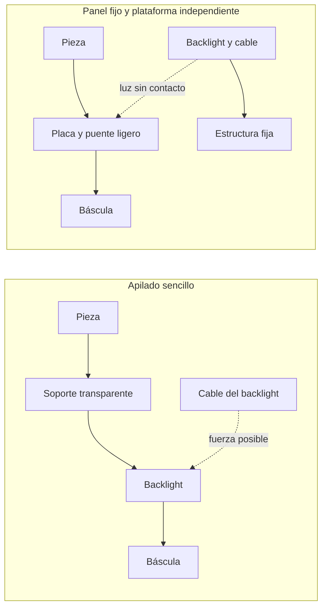

# Soporte, montaje y uso con varios materiales

La aclaración del usuario amplía el diseño más allá de PP. Mantener una **plataforma y apoyos intercambiables**, parámetros de iluminación por condición y ensayos con muestras es más defendible que fabricar ya una ranura ajustada a una única pieza nominal.

## Qué indican las fotos y qué falta confirmar

Referencias: [vista lateral original](../../../docs/assets/presentation/media/image5.jpeg) y [vista oblicua superior](../../../docs/assets/presentation/media/image6.jpeg). Se aprecian coladas largas, zonas elevadas y pequeños salientes en algunas vueltas. En la zona central parece existir un extremo que baja por debajo del plano de ciertas vueltas. **Observaciones visuales, sin escala calibrada ni sección CAD confirmada.**

Consecuencias para investigar:

- Un apoyo plano podría no apoyar donde suponemos si hay un saliente inferior en la unión de colada.
- Los salientes pueden ser detalles intencionados, rebabas u otra geometría: no clasificarlos como defectos sin referencia.
- No se ha demostrado que la sección sea circular. Hasta confirmarlo, el resultado cenital debe llamarse **ancho aparente en el plano de medida**, no diámetro circular 3D.
- La base de colada y el comienzo del hilo necesitan una definición de inicio. Una región oculta no puede rellenarse con el nominal y presentarse como medida.

La revisión en SolidWorks quedó pendiente al detenerse el control del ordenador con Escape. No hay cotas nuevas extraídas del CAD.

## Opciones de apoyo

| Apoyo | Ventaja | Riesgo / prueba decisiva |
| --- | --- | --- |
| Placa plana con topes holgados | No obliga a seguir toda la espiral nominal; sencilla de limpiar y cambiar | Puede conservar alabeo; comprobar saliente central y variación de altura |
| Placa con hueco local para extremo inferior de colada | Evita que ese extremo levante toda la pieza, si existe | El hueco introduce bordes propios y puede cortar la iluminación; necesita cota real |
| Ranura completa con holgura | Facilita localización lateral | No necesariamente aplana; puede ocultar contorno, retener suciedad o restringir contracción |
| Sujeción ligera localizada | Puede controlar altura en puntos concretos | La reacción debe cerrar dentro del conjunto pesado; puede deformar material caliente o blando |
| Tapa transparente | Puede bajar las vueltas y aislar corrientes | Añade reflejos, contacto, fuerza y manipulación; necesita espacio para colada y una condición de fuerza definida |

La fuerza de un pisador fijado a la columna pasa a formar parte de la lectura de la báscula. Un soporte que toca la mesa o la estructura exterior también desvía carga. Si se ensaya sujeción, sus puntos de reacción deben estar en el conjunto pesado o debe separarse la fase de pesaje de la de sujeción y documentarlo. No se selecciona aún una de estas opciones.

## Metacrilato y vidrio: alternativas, no solución universal

Se conservan datos de [PLEXIGLAS GS/XT](../../components/datasheets/PLEXIGLAS_GS_XT.pdf) en el primer estudio. Su facilidad de mecanizado favorece prototipos, pero una ranura caliente no es un patrón dimensional fijo y puede rayarse/ensuciarse.

[SCHOTT BOROFLOAT 33](sources/SCHOTT_BOROFLOAT33_technical_data.pdf) publica densidad 2,23 g/cm³, módulo de Young 64 GPa y expansión lineal de 3,25·10⁻⁶/K entre 20 y 300 °C. La ficha también advierte que la resistencia al impacto depende de montaje, dimensiones, agujeros y estado superficial. **No valida una placa perforada ni el espesor de nuestro soporte.**

Masas calculadas para placas macizas, sin herrajes:

| Placa de 200 × 200 mm | Masa calculada |
| --- | ---: |
| PMMA, 5 mm | 238 g |
| PMMA, 10 mm | 476 g |
| BOROFLOAT 33, 3 mm | 267,6 g |

El vidrio es más denso, pero una placa más fina puede pesar menos que un soporte grueso de PMMA. Hace falta estudiar apoyo perimetral, resistencia y fabricación; **3 mm es un ejemplo de masa, no un espesor aprobado**. El vidrio tampoco elimina estática. La cámara superior ve la pieza sin atravesar la placa de apoyo situada debajo; añadir una tapa encima sí introduce otra interfaz óptica en el recorrido de observación.

## Dos rutas de carga para el montaje del PowerPoint

Son rutas de carga, no planos constructivos. La variante A simplifica la primera maqueta; la B reduce carga y fuerzas de cables, pero necesita resolver el paso del puente alrededor del panel. Por ejemplo, un panel TPL de 204 mm útiles mide 214 mm por fuera: no cabe automáticamente entre patas que apoyen directamente dentro de un plato de 196 × 160 mm. Un bastidor de base más ancho, una conexión lateral o pesaje suspendido añadirían rigidez/momentos que deben comprobarse. **No prometer una base de 300 × 300 mm antes de dibujar las envolventes.**

Para el primer prototipo conviene comparar el apilado con un puente provisional ligero y medir el efecto de cables/excentricidad. No fabricar el puente definitivo solo para poder usar la báscula de 1,1 kg: la alternativa de 5 kg puede reducir esa presión de diseño si supera los ensayos.

## Materiales: matriz de condiciones, no una receta única

| Condición de la pieza | Qué puede cambiar | Comprobación útil |
| --- | --- | --- |
| Opaca y rígida | Normalmente favorece silueta; redondeo y rebabas siguen afectando | Referencia de ancho, barrido de exposición y recolocación |
| Clara, translúcida o pigmentación variable | Transmisión, dispersión, refracción y borde doble | Perfiles en gris con luz difusa/semicollimada; comparar color de iluminación si hace falta |
| Blanda o recién desmoldeada | Contacto del calibre o soporte puede cambiar sección y recorrido | Comparar fuerzas/apoyos y medir condición temporal de la pieza |
| Reforzada o con orientación marcada | Contracción y deformación pueden no ser isotrópicas | No corregir toda la geometría mediante un único factor de escala asumido |
| Higroscópica | Masa y dimensiones pueden cambiar con acondicionamiento | Identificar grado, lote, secado y tiempo desde moldeo cuando sea relevante |

La documentación de [Toray sobre AMILAN](https://www.plastics.toray/de/technical/amilan/tec_011.html) distingue contracción, temperatura, orientación y absorción de humedad en sus poliamidas. Se toma como evidencia de que otras familias necesitan condiciones propias; **no se usan sus coeficientes para predecir nuestra espiral de PP**.

La medida inmediata solicitada puede ser un indicador de proceso útil aunque no coincida con dimensiones a temperatura ambiente. Para compararla entre ciclos hay que conocer cuánto cambia en los primeros instantes. Esto es una condición de la pieza y del soporte, no un problema que se resuelva acelerando el software.

## Cambios que haría al concepto, sujetos a pruebas

1. Mantener cámara cenital, báscula y backlight; prever ajuste de cámara alrededor de la distancia estimada para 35 mm.
2. Brazo corto y arriostrado, columna/cámara fuera de la carga pesada. Separar esfuerzos de colocar la pieza de movimientos de la cámara.
3. Apoyo reemplazable, primero plano o con alivio local de colada; evitar una ranura nominal completa hasta ver qué deforma u oculta.
4. Espacio para panel y pantalla contra luz ambiente, sin que ninguna pantalla toque pieza/plataforma.
5. Confirmar si se necesita sacar el panel de la carga después de medir masa y deriva, no por los 2 kg estimados inicialmente.
6. Conservar imágenes de pieza completa y regiones excluidas visibles. Documentar la condición de apoyo y material con cada resultado.
